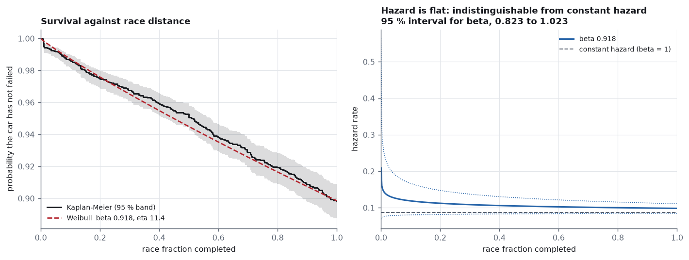
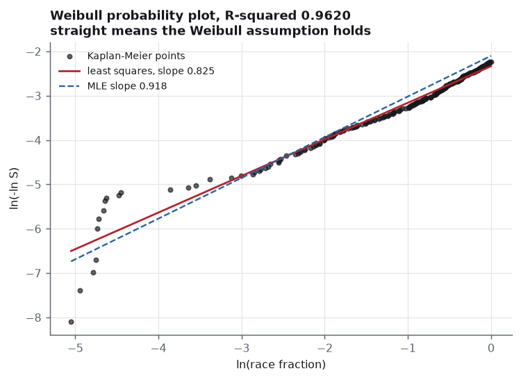
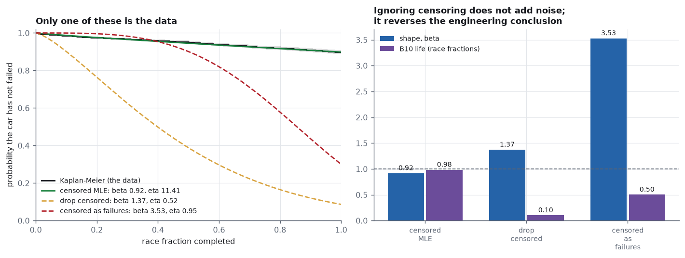
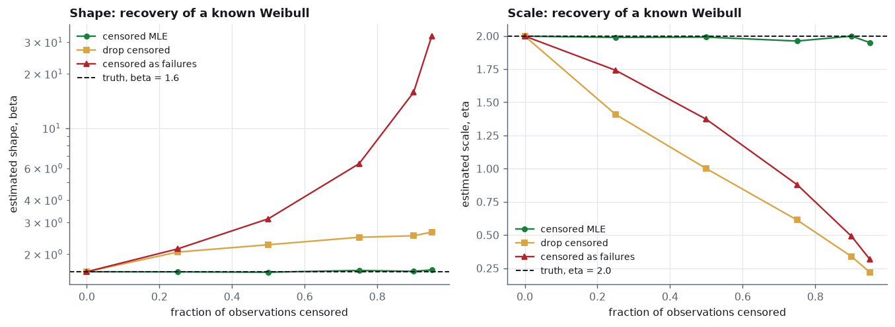
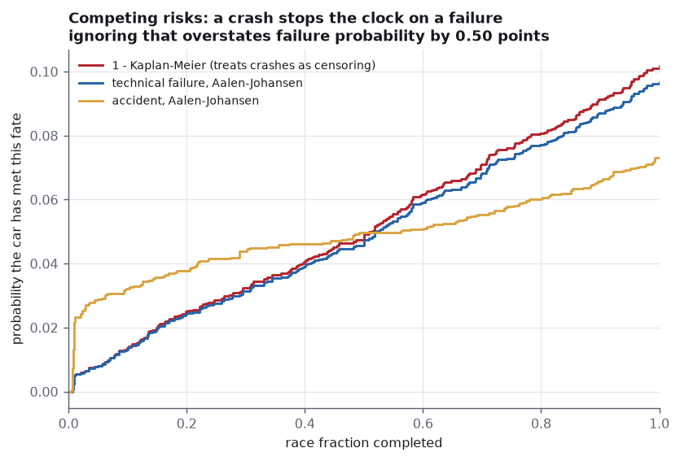
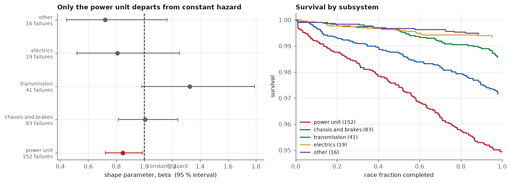
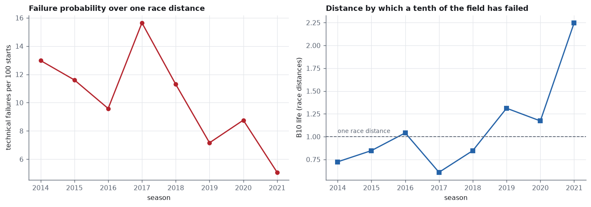
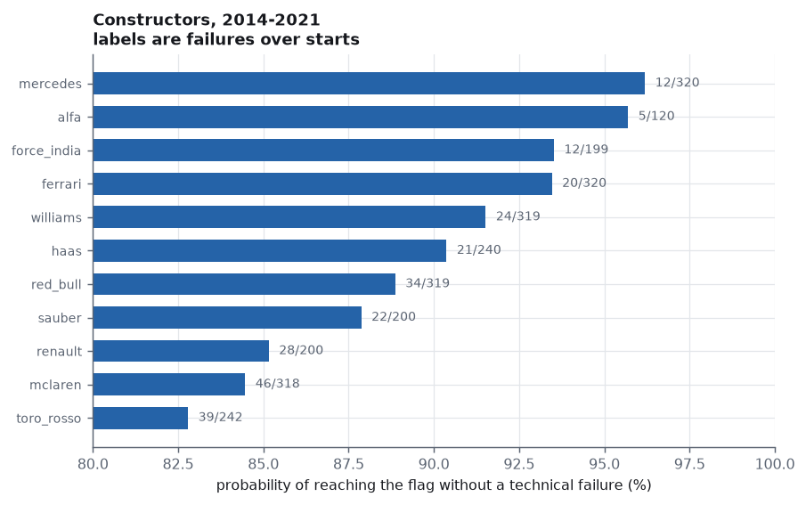

# Reliability Weibull

Survival analysis of 3,257 Formula 1 car-races, 2014–2021, as a reliability
problem: when does a car fail, what shape is its hazard, and how much of the
answer depends on handling the 90% of cars that did **not** fail.

The short version: **90.4% of the observations are censored, and getting
them wrong reverses the conclusion.** Counting finishers as failures at the
chequered flag — the mistake that costs nothing in code and everything in
meaning — returns a Weibull shape of **β = 3.53**, a confident wear-out
signature. The right likelihood returns **β = 0.918, 95% CI 0.824–1.023**:
over a race distance an F1 car's hazard is statistically indistinguishable
from constant, and no wear-out can be demonstrated at all.



```
python run.py              # fetch, fit, chart, report  (~1 min)
python run.py --refresh    # re-fetch the race results
python -m pytest tests/    # 42 tests
```

Output: `out/report.html`, self-contained, charts inlined.

---

## The data, and the three decisions before any fitting

Race results from the open [Jolpica](https://api.jolpi.ca/ergast/f1/) mirror
of the Ergast schema — no key, no login. 2014 through 2021: **3,267
car-races**, of which 3,257 carry exposure.

Both ends of the window are forced. 2014 is the first season of the V6
hybrid power unit, so earlier cars are a different machine under a different
rulebook. 2021 is where the feed stops recording *why* a car retired:

| season | distinct statuses | named causes | rows with a named cause |
|---:|---:|---:|---:|
| 2014 | 30 | 24 | 78 |
| 2018 | 28 | 23 | 83 |
| 2021 | 26 | 21 | 56 |
| 2024 | 5 | 2 | 5 |
| 2026 | 4 | 1 | 7 |

From 2022 the feed reports that a car retired, not what broke. A reliability
analysis of 2024 would be an analysis of the word "Retired", so the window
ends where the causes do.

### 1. What counts as a failure?

A crash is not a reliability event. All 59 statuses in the window are
sorted explicitly, and the handful that are a judgement rather than a
reading are listed in `AMBIGUOUS` with the reasoning attached to each one:

| cause | n | share | treated as |
|---|---:|---:|---|
| technical | 311 | 9.55% | **failure** |
| accident | 234 | 7.18% | competing risk, censored |
| unknown | 38 | 1.17% | censored, with a sensitivity check |
| operational | 4 | 0.12% | censored (pit crew, not component life) |
| driver | 2 | 0.06% | censored |
| finished | 2,668 | 81.92% | censored at its own distance |

`Puncture` and `Tyre` go to accidents — in this era they come from debris or
contact far more often than from a tyre defect, and the tyre is supplied
rather than built. `Wheel` is the car's; `Wheel nut` is the pit crew's.
Every such call is in the code, not in this README, so it cannot drift.

### 2. When did it fail?

The feed reports *completed* laps. A car credited with five laps retired
during lap six, so its failure time lies in the interval (5, 6] and is
placed at the midpoint:

```
failure time   = (laps + 0.5) / race_laps
censoring time =  laps        / race_laps     (finishers: no half lap added)
```

This is not cosmetic. It is what makes the cars credited with **zero** laps
usable — 96 of the 104 carry exposure, and they failed during lap one, not
at time zero, where a Weibull cannot take a failure at all. Dropping them
instead would throw away eighteen real technical failures and bias every
estimate toward late life.

### 3. On what scale?

Race fraction, not laps. F1 race distance is regulated to a minimum of
305 km, so the fraction of the winner's distance is comparable between a
44-lap Spa and a 78-lap Monaco. A lapped finisher is censored at its own
fraction, not at 1.0: it ran the full race *time* but covered less
*distance*, and on a distance scale what is known is the distance it
actually covered.

---

## Finding 1 — the hazard is flat, and the shape is the whole answer

The Weibull survivor function is `S(t) = exp(−(t/η)^β)`, and β is a claim
about the physics rather than a curve-fitting nuisance: below 1 the hazard
falls with age (infant mortality), at 1 it is constant (failures arrive
without memory), above 1 it rises (wear-out).

| quantity | value |
|---|---|
| β (shape) | **0.9180 ± 0.0509**, 95% CI 0.8235–1.0233 |
| η (scale) | 11.4121 ± 1.7250 race distances |
| B10 life | 0.9833 race distances |
| Kaplan–Meier survival to the flag | 0.8983 (0.8870–0.9085) |
| restricted mean race fraction | 0.9484 |
| likelihood ratio vs the exponential | χ² = 2.454, p = 0.117 |

The interval for β contains 1 and the likelihood ratio against the
exponential does not reject it. **A race distance is short compared with the
life of the parts**, which is the engineering reading: cars are built to
finish, so what the data sees is the early, flat part of the hazard, not the
wear-out knee.

An independent check on the shape, owing nothing to the likelihood: the
Weibull probability plot of `ln(−ln S)` against `ln t` has slope **0.8254**
against the MLE's 0.9180, with R² = 0.9620.



**η is an extrapolation and is reported as one.** No car in the data runs
past 1.0 race distances, so a characteristic life of 11.4 rests on the
Weibull shape holding roughly ten times beyond anything observed. The B10
life of 0.98 sits inside the data and is firm; η and the mean life are not,
and a test pins that distinction so a future change cannot quietly make this
paragraph wrong.

---

## Finding 2 — what the censored observations are worth

Three ways to handle the 2,946 cars that did not suffer a technical failure:

| handling | n | d | β | η | B10 |
|---|---:|---:|---:|---:|---:|
| **censored MLE** (correct) | 3,257 | 311 | **0.918** | 11.412 | 0.983 |
| drop the censored | 311 | 311 | 1.371 | 0.521 | 0.101 |
| count them as failures | 3,257 | 3,257 | 3.529 | 0.949 | 0.501 |



Dropping the survivors throws away every long life, so the scale collapses
to the failures' own range and the B10 life falls by a factor of ten.
Counting them as failures preserves the sample size and destroys the
physics: a population in which 90% of units "fail" at almost exactly the
same distance looks like a hard wear-out limit, so β climbs to 3.53 and the
answer inverts from "no detectable wear-out" to "confident wear-out".

### The machinery is validated against a known truth

None of the above is evidence on its own — a fitter that is simply broken
would also disagree with itself. So the same three methods are run on data
simulated from a Weibull whose parameters are fixed in advance (β = 1.6,
η = 2.0) and censored deliberately:



| censoring | censored MLE | drop censored | count as failures |
|---:|---|---|---|
| 0% | 1.599 / 1.999 | 1.599 / 1.999 | 1.599 / 1.999 |
| 25% | 1.596 / 1.989 | 2.055 / 1.409 | 2.140 / 1.742 |
| 50% | 1.589 / 1.991 | 2.257 / 1.000 | 3.143 / 1.372 |
| 75% | 1.625 / 1.962 | 2.483 / 0.613 | 6.352 / 0.879 |
| **90%** | **1.607 / 1.999** | 2.530 / 0.337 | **15.798 / 0.490** |
| 95% | 1.637 / 1.950 | 2.651 / 0.219 | 32.395 / 0.317 |

With nothing censored all three are the same estimator and agree to three
decimals, which is the control. At the real dataset's 90% the correct
likelihood still returns 1.607 against a true 1.6, and "count them as
failures" returns 15.798 — an error of a factor of ten in the parameter that
carries the entire engineering meaning.

---

## Finding 3 — a crash is a competing risk, not censoring

The 234 accidents cannot simply be censored as though they were
uninformative: a car that crashes on lap 3 is removed from the population,
and treating it as "still at risk, just unobserved" credits it with
reliability it never demonstrated. The Aalen–Johansen estimator handles
this; one minus Kaplan–Meier does not.



| | probability by the flag |
|---|---:|
| technical failure, Aalen–Johansen | **0.0968** |
| technical failure, naive 1 − KM | 0.1017 (+0.50 pts, 1.051×) |
| accident | 0.0732 |
| all incidences + survival | 1.000000 |

The naive figure overstates the failure probability by 5.1% relative, which
is modest here only because the competing risk is modest. The closure to
exactly one is the identity that catches almost any error in this estimator,
and it is a test rather than a remark.

---

## Finding 4 — the power unit is the one component that is not flat

Fitting each subsystem against the same exposure, with the failures of other
subsystems censored:



| subsystem | d | β | 95% CI | S(1) | verdict |
|---|---:|---:|---|---:|---|
| power unit | 152 | 0.846 | 0.724–0.989 | 0.9490 | **infant mortality** |
| chassis and brakes | 83 | 1.006 | 0.815–1.241 | 0.9718 | constant |
| transmission | 41 | 1.326 | 0.983–1.789 | 0.9857 | constant |
| electrics | 19 | 0.807 | 0.520–1.253 | 0.9936 | constant |
| other | 16 | 0.720 | 0.446–1.162 | 0.9946 | constant |

The power unit is the only subsystem whose interval clears 1, and it clears
it downward: its hazard **falls** with distance. That is the signature of
something that either survives the first stint or does not — which is what a
1.6-litre V6 turbo hybrid at 15,000 rpm on a limited parts allocation looks
like when it fails. The transmission points the other way (β = 1.33, heat
and load cycles) but its interval still touches 1 with 41 failures, so the
claim is not made.

---

## Finding 5 — the hybrid era got three times better



| season | failures / starts | failure probability | B10 life |
|---:|---:|---:|---:|
| 2014 | 50 / 405 | 12.98% | 0.724 |
| 2015 | 40 / 375 | 11.61% | 0.847 |
| 2016 | 41 / 460 | 9.59% | 1.041 |
| 2017 | 58 / 400 | 15.65% | 0.609 |
| 2018 | 45 / 420 | 11.30% | 0.847 |
| 2019 | 28 / 419 | 7.16% | 1.311 |
| 2020 | 28 / 339 | 8.76% | 1.172 |
| 2021 | 21 / 439 | 5.07% | 2.248 |

B10 life improves **3.11×** across the window, and the log-rank test of 2014
against 2021 rejects equality. 2017 is the worst season in the window, not
2014 — the 2017 aerodynamic regulation change raised downforce and with it
the load on everything carrying it, and the cost shows up in the survival
curve rather than in the lap times.

## The constructors



Eleven teams with at least 100 starts:

| team | failures / starts | S(1) | RMST |
|---|---:|---:|---:|
| mercedes | 12 / 320 | 0.9619 | 0.9796 |
| alfa | 5 / 120 | 0.9570 | 0.9811 |
| force_india | 12 / 199 | 0.9352 | 0.9726 |
| ferrari | 20 / 320 | 0.9346 | 0.9588 |
| williams | 24 / 319 | 0.9152 | 0.9724 |
| haas | 21 / 240 | 0.9037 | 0.9576 |
| red_bull | 34 / 319 | 0.8887 | 0.9359 |
| sauber | 22 / 200 | 0.8787 | 0.9448 |
| renault | 28 / 200 | 0.8516 | 0.9144 |
| mclaren | 46 / 318 | 0.8447 | 0.9305 |
| toro_rosso | 39 / 242 | 0.8279 | 0.9164 |

Log-rank, Mercedes against Toro Rosso: **χ² = 27.78, p = 1.36e-07**, with
Mercedes observing 0.394 of its expected failures. The gap is not sampling
noise. It is also not a clean constructor comparison — a team's power unit
supply, its budget and its seasons are all tangled together in these
columns, and nothing here separates them.

## The 38 unexplained retirements

`Retired`, with no cause given, is kept as its own category rather than
quietly folded into either side. Both defensible treatments are reported:

| treatment | d | β | η | S(1) |
|---|---:|---:|---:|---:|
| censored (default) | 311 | 0.9180 | 11.412 | 0.8983 |
| counted as failures | 349 | 0.9196 | 10.024 | 0.8866 |

β moves by 0.0016. The conclusion does not depend on the choice, which is
worth 38 records of arithmetic to be able to say.

---

## Three things that changed during the build

**η was the headline, and should not have been.** The first draft led with a
characteristic life of 11.4 race distances, which reads as a strong result
and is in fact an extrapolation ten times past anything in the data — the
fit sees about 8.8% of that life. The headline is now the shape and the B10
life, both of which sit inside the observed range, and the extrapolation is
labelled as one in the code, in the report and in a test.

**`Retired` was folded into technical failures.** It is the single largest
ambiguous status, and lumping it in would have meant 349 failures with no
statement about where 38 of them came from. It is now its own category with
the sensitivity reported above, which is both more honest and a better
result: the answer turns out not to depend on it.

**The log-log confidence band overflowed when the risk set emptied.** The
last event in a fully observed sample takes the number at risk to zero,
which sends Greenwood's variance to infinity and the band's exponent past
the floating-point range. The band was already the full [0, 1] there, so no
published number moved, but it was arriving via `inf` and a `nan_to_num`
rather than by intent. Caught by the test that asserts the band stays inside
[0, 1]; now capped explicitly, with the reason in a comment.

---

## What this does not do

- **Race fraction is a proxy for distance, not distance.** Monaco is the
  standing exception at about 260 km, and a lap is harder on a car at some
  circuits than at others. Neither is modelled.
- **No covariates.** This is an unconditional survival analysis. There is no
  Cox model, so season, team, power unit supplier and circuit are never held
  constant while another is varied — the breakdowns above are marginal, and
  the constructor table in particular confounds all four.
- **Competing risks assume independence.** The Aalen–Johansen estimator
  needs the accident hazard to carry no information about the technical
  hazard. A failing car that becomes hard to drive and then crashes violates
  that, and nothing here detects it.
- **Interval censoring is handled by a midpoint, not a likelihood.** Every
  failure time is known only to within one lap. A proper interval-censored
  likelihood would be stricter; at 44 to 78 laps a race the half-lap is
  about 1% of the scale.
- **The window ends in 2021** because the cause data does, so none of this
  describes the current regulations.
- **A failure here is a retirement, not a defect.** A car retired to save a
  component for the next race is recorded as that component's failure, and
  the feed does not distinguish it from a component that actually broke.

---

## Fachbegriffe

| English | Deutsch |
|---|---|
| reliability | Zuverlässigkeit |
| survival analysis | Überlebenszeitanalyse, Ereigniszeitanalyse |
| survivor function | Überlebensfunktion |
| hazard rate | Ausfallrate, Hazardrate |
| cumulative hazard | kumulierte Ausfallrate |
| failure | Ausfall |
| retirement (race) | Ausfall, Aufgabe |
| right censoring | Rechtszensierung |
| censored observation | zensierte Beobachtung |
| interval censoring | Intervallzensierung |
| competing risk | konkurrierendes Risiko |
| cumulative incidence | kumulative Inzidenz |
| at risk | unter Risiko, Risikomenge |
| Weibull shape / scale | Weibull-Formparameter / Skalenparameter |
| characteristic life | charakteristische Lebensdauer |
| infant mortality | Frühausfälle, Frühausfallphase |
| wear-out | Verschleißausfälle, Spätausfallphase |
| bathtub curve | Badewannenkurve |
| B10 life | B10-Lebensdauer |
| mean time to failure | mittlere Lebensdauer |
| maximum likelihood | Maximum-Likelihood-Methode |
| likelihood ratio test | Likelihood-Quotienten-Test |
| confidence interval | Konfidenzintervall |
| observed information | beobachtete Information |
| product-limit estimator | Produkt-Limit-Schätzer |
| log-rank test | Log-Rang-Test |
| probability plot | Wahrscheinlichkeitsnetz |
| goodness of fit | Anpassungsgüte |
| power unit | Antriebseinheit |
| transmission | Getriebe |
| sensitivity analysis | Sensitivitätsanalyse |

---

## Layout

```
src/
  data.py         fetch and cache the results feed; status granularity survey
  lifetimes.py    classify the statuses, the half-lap convention, the scale
  survival.py     Kaplan-Meier with Greenwood, Nelson-Aalen, log-rank,
                  Aalen-Johansen competing risks, RMST
  weibull.py      right-censored MLE by profile likelihood, standard errors,
                  the exponential closed form, the naive comparisons
  charts.py       eight figures
  report.py       one self-contained HTML file
tests/
  test_reliability.py   42 tests, anchored on closed forms and hand examples
data/
  results.json    3,267 cached car-races
out/              figures and report, committed so the README renders
run.py
```

## Sources

- Race results: [Jolpica](https://api.jolpi.ca/ergast/f1/) (Ergast schema,
  unauthenticated).
- Kaplan, E. L. and Meier, P., "Nonparametric estimation from incomplete
  observations", *JASA* 53(282), 1958.
- Greenwood, M., "The natural duration of cancer", *Reports on Public Health
  and Medical Subjects* 33, 1926.
- Aalen, O. O. and Johansen, S., "An empirical transition matrix for
  non-homogeneous Markov chains based on censored observations",
  *Scandinavian Journal of Statistics* 5(3), 1978.
- Nelson, W., *Applied Life Data Analysis*, Wiley, 1982 — the censored
  Weibull likelihood and the probability plot.
- Abernethy, R. B., *The New Weibull Handbook*, 5th ed., 2006 — B10 life and
  the interpretation of the shape.
- IEC 61649, *Weibull analysis*.

Co-authored with Claude Opus 5.
